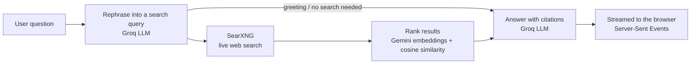

# Perplexed — AI Answer Engine

A Perplexity-style AI search assistant that combines a large language model with live web search to produce **grounded, cited answers**. Ask a question, and Perplexed searches the web, ranks the best sources, and streams back an answer with numbered citations you can click.

Built with a TypeScript/Express backend (LangChain), a React + Vite frontend, and a self-hosted [SearXNG](https://docs.searxng.org/) instance as the search provider — no third-party search API needed.

**Live demo:** https://perplexity-frontend-nct0.onrender.com

## Features

- **Cited answers** — the answer streams in token by token, with clickable `[1]`, `[2]` citations linked to the real source pages
- **Seven focus modes**
  - **Web** — search the entire web
  - **Academic** — papers and journals (arXiv, Google Scholar, PubMed, Internet Archive Scholar)
  - **Reddit** — discussions from Reddit
  - **YouTube** — videos from YouTube
  - **Image** — image search results in a grid with a full-size viewer
  - **Video** — video results with an in-page player
  - **Writing** — writing help with no web search
- **Follow-up conversations** — chat history is sent along, so follow-up questions work in context
- **Suggested follow-ups** after every answer
- **Landing page** with example questions, which disappears as soon as you search
- **Dark / light theme** switch
- **Responsive layout** tuned for phones, tablets and desktop
- **Self-hosted search** through SearXNG

## How it works



1. The user's question and chat history are turned into a standalone search query. Greetings and small talk skip the search.
2. SearXNG returns results from several search engines.
3. Result snippets are embedded with Gemini and ranked by similarity to the query.
4. The top sources are passed to the LLM, which writes an answer with inline citations.
5. The answer, the sources, and suggested follow-ups stream back to the browser.

## Tech Stack

| Layer | Technology |
|---|---|
| Frontend | React 19, Vite, TypeScript, Tailwind CSS 4, Framer Motion, React Router, react-markdown, lucide-react |
| Backend | Node.js, Express, TypeScript, LangChain, tsx |
| LLM | [Groq](https://groq.com/) (`openai/gpt-oss-120b`) |
| Embeddings | Google Gemini (`gemini-embedding-001`) |
| Search | [SearXNG](https://github.com/searxng/searxng), run with Docker |

## Project Structure

```
perplexed-ai-answer-engine/
├── backend/
│   ├── src/
│   │   ├── agents/          # One agent per focus mode (web, academic, reddit, ...)
│   │   ├── controllers/     # Request handling and SSE streaming
│   │   ├── routes/          # API routes
│   │   ├── services/        # SearXNG client
│   │   ├── lib/             # LLM (Groq) and embeddings (Gemini) setup
│   │   ├── utils/           # Reranking, stream handling, history formatting
│   │   ├── app.ts           # Express app and CORS
│   │   └── index.ts         # Server entry point
│   ├── searxng/             # SearXNG settings and Dockerfile
│   ├── docker-compose.yml   # Runs SearXNG locally
│   └── .env.example
└── frontend/
    ├── src/
    │   ├── pages/           # Home (landing) and SearchPage (results)
    │   ├── components/      # chat, search and layout components
    │   ├── hooks/           # useChat (streaming state)
    │   ├── lib/             # API client and helpers
    │   └── index.css        # Theme and responsive styles
    └── .env.example
```

## Prerequisites

- [Node.js](https://nodejs.org/) 20.19+ (or 22.12+) and npm
- [Docker Desktop](https://www.docker.com/products/docker-desktop/) (with the WSL2 backend on Windows)
- A free **Groq** API key — https://console.groq.com/keys
- A free **Gemini** API key — https://aistudio.google.com/apikey

## Setup

### 1. Clone and install

```bash
git clone https://github.com/Vedant7024/perplexed-ai-answer-engine.git
cd perplexed-ai-answer-engine

cd backend
npm install

cd ../frontend
npm install
```

### 2. Configure environment variables

Create `backend/.env` (copy it from `backend/.env.example`):

```env
GROQ_API_KEY=your_groq_key_here
GEMINI_API_KEY=your_gemini_key_here
PORT=3001
SEARXNG_URL=http://localhost:4000
```

Optionally, create `frontend/.env`. If you skip it, the frontend assumes the backend is at `http://localhost:3001`:

```env
VITE_API_URL=http://localhost:3001
```

> **Important:** no quotes, and no spaces around `=`. The `.env` file is read only when the backend starts, so restart it after any change. Never commit your `.env` file — it is already listed in `.gitignore`.

| Variable | Where | Description |
|---|---|---|
| `GROQ_API_KEY` | backend | Groq API key (LLM) |
| `GEMINI_API_KEY` | backend | Google Gemini API key (embeddings) |
| `PORT` | backend | Backend port (default `3001`) |
| `SEARXNG_URL` | backend | SearXNG address (default `http://localhost:4000`) |
| `FRONTEND_URL` | backend | Your deployed frontend URL, allowed through CORS (production only) |
| `VITE_API_URL` | frontend | Backend address (default `http://localhost:3001`) |

### 3. Start SearXNG (search backend)

Make sure Docker Desktop is running, then from the `backend` folder:

```bash
cd backend
docker compose up -d
```

Verify it works by opening this in your browser:

```
http://localhost:4000/search?q=test&format=json
```

You should see JSON with a list of `results`.

> **Note:** `search.formats` in `backend/searxng/settings.yml` must include `json`, because SearXNG disables the JSON API by default:
> ```yaml
> search:
>   formats:
>     - html
>     - json
> ```
> Some engines (for example DuckDuckGo or Startpage) may show up under `unresponsive_engines` because of CAPTCHAs. That is normal as long as other engines return results.

### 4. Start the backend

```bash
cd backend
npm run dev
```

The backend runs on **http://localhost:3001**. Check it at `http://localhost:3001/health`.

### 5. Start the frontend

```bash
cd frontend
npm run dev
```

The frontend runs on **http://localhost:5173**.

### 6. Open the app

Visit **http://localhost:5173** and start asking questions.

## Scripts

| Folder | Command | What it does |
|---|---|---|
| `backend` | `npm run dev` | Start with auto-reload (tsx watch) |
| `backend` | `npm run build` | Compile TypeScript to `dist/` |
| `backend` | `npm start` | Run the compiled build |
| `frontend` | `npm run dev` | Start the Vite dev server |
| `frontend` | `npm run build` | Type-check and build for production |
| `frontend` | `npm run preview` | Preview the production build |
| `frontend` | `npm run lint` | Lint with oxlint |

## API

### `GET /health`

Returns `{ "status": "ok" }`.

### `POST /api/chat`

```json
{
  "query": "what is retrieval augmented generation",
  "chatHistory": [
    { "role": "user", "content": "..." },
    { "role": "assistant", "content": "..." }
  ],
  "focusMode": "webSearch"
}
```

`focusMode` is one of: `webSearch`, `academicSearch`, `redditSearch`, `youtubeSearch`, `imageSearch`, `videoSearch`, `writingAssistant`.

**Streaming modes** (web, academic, Reddit, YouTube, writing) respond with Server-Sent Events. Each event is a `data:` line containing JSON with a `type`:

| `type` | `data` |
|---|---|
| `sources` | List of source documents used for the answer |
| `response` | A chunk of the answer text |
| `suggestions` | Suggested follow-up questions |
| `done` | The stream is finished |
| `error` | An error message |

**Image and video modes** respond with plain JSON:

```json
{ "success": true, "data": { "results": [], "suggestions": [] } }
```

## Windows Setup Notes (Docker / WSL2)

If `docker` commands aren't recognized, or the engine isn't running:

1. Install WSL2 (run PowerShell as Administrator), then restart your machine:
   ```powershell
   wsl --install
   ```
2. Install [Docker Desktop](https://www.docker.com/products/docker-desktop/) and keep "Use WSL 2 instead of Hyper-V" enabled.
3. Restart again, open Docker Desktop, and wait until it shows **Engine running**.
4. Verify from a **new** terminal window:
   ```powershell
   docker --version
   ```

## Troubleshooting

**Every answer says "I don't have enough information" or the answer never appears**
Check the backend terminal. Most often it is one of these:
- `401 Unauthorized` from Gemini → the `GEMINI_API_KEY` is missing or wrong. Fix `backend/.env` and restart the backend.
- `SearXNG returned results: 0` → SearXNG is down or its engines are blocked. See the SearXNG items below.

**`429 Rate limit reached` from Groq**
The free tier has a tokens-per-minute limit. Wait a few seconds and try again, or upgrade your Groq plan. The backend retries automatically a few times.

**`no configuration file provided: not found`**
Run `docker compose` from the `backend` folder, where `docker-compose.yml` lives.

**`failed to connect to the docker API at npipe:////./pipe/dockerDesktopLinuxEngine`**
Docker Desktop isn't running. Open it and wait for **Engine running**.

**`The container name "/searxng" is already in use`**
Remove the old container, then start again:
```bash
docker rm -f searxng
docker compose up -d
```

**`connect ECONNREFUSED ::1:4000` / `127.0.0.1:4000`**
SearXNG isn't running. From the `backend` folder run `docker compose up -d`.

**SearXNG container exits immediately or keeps restarting**
Check the logs:
```bash
docker logs searxng
```

**Frontend can't reach the backend**
Check that `VITE_API_URL` points at the backend port (`3001`), that the backend is running, and that `http://localhost:3001/health` responds.

## Deployment

The project can be hosted as three services: the frontend (static site), the backend (Node web service), and SearXNG (a separate container, see `backend/searxng/Dockerfile`).

- Set `SEARXNG_URL` on the backend to your hosted SearXNG address.
- Set `FRONTEND_URL` on the backend to your frontend's URL so CORS allows it.
- Set `VITE_API_URL` on the frontend to your backend's URL before building.
- Add `GROQ_API_KEY` and `GEMINI_API_KEY` as environment variables on the backend host. Never put them in the repository.

## Author

Made by **Vedant Sharma**.

## License

This project is for educational and personal use.